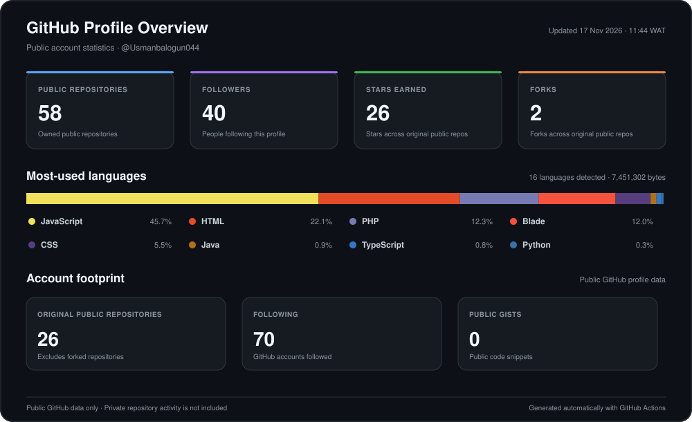

# Usman Balogun

**Backend Software Engineer · PHP / Laravel · API Engineering · System Design · Security**  
Nigeria 🇳🇬

  
  
  
  
  

---

## About Me

I'm a Backend Software Engineer with **5–7 years of professional experience**, primarily working with **PHP and Laravel**. I design, build, secure, and maintain production backend systems, with a focus on clean architecture, reliable APIs, database performance, integrations, and maintainable business logic.

I enjoy taking ownership of backend engineering from technical planning and database design through implementation, testing, deployment, debugging, and ongoing production support.

I also bring a security-first mindset to software development, supported by my cybersecurity background and **Certified Ethical Hacker (CEH)** training. Alongside Laravel, I'm expanding my work with **Golang and Gin** for performance-oriented backend services.

- 🔭 Currently building and maintaining backend systems.
- ⚙️ Main focus: Laravel, PHP, REST APIs, databases, and system design.
- 🔐 Interested in application security, performance, and reliable infrastructure.
- 🌱 Exploring Go/Gin for high-throughput backend services.
- 🤝 Open to remote backend engineering roles and meaningful engineering collaborations.

---

## Engineering Focus

| Area | Tools and experience |
|---|---|
| Backend engineering | PHP, Laravel, Golang, Gin, REST APIs, system design |
| Data and performance | MySQL, PostgreSQL, Redis, indexing, query optimisation, caching |
| Application architecture | Authentication, authorisation, RBAC, integrations, business logic |
| Async processing | Queues, background jobs, cron scheduling, notifications, webhooks |
| Payments and platforms | Payment gateways, wallet workflows, transactions, subscriptions, billing |
| Infrastructure | Docker, Linux, Nginx, Cloudflare, CI/CD, deployment |
| Security | OWASP Top 10, secure coding, vulnerability assessment, Burp Suite, Nmap |

---

## Tech Stack

**Languages**

**Frameworks and Runtime**

**Databases and Cache**

**Infrastructure and Tools**

**Security**

OWASP Top 10 · Burp Suite · Nmap · Wireshark · SQLMap · Secure Coding · Vulnerability Assessment

---

## GitHub Analytics

  

## Contribution Calendar

  

## Coding Habits

  

> These profile graphics are generated and refreshed automatically with GitHub Actions. The first run creates the SVG files in the `profile/` directory.

---

## Connect

  <a href="https://github.com/Usmanbalogun044">GitHub</a> ·
  <a href="https://www.linkedin.com/in/balogun-usman-5a5176272/">LinkedIn</a> ·
  <a href="https://balogunusmantemitope.vercel.app">Portfolio</a> ·
  <a href="https://dev.to/itszed0">Dev.to</a> ·
  <a href="mailto:usmanbalogun044@gmail.com">Email</a>

---

  <i>"The best backend is the one no one talks about because it just works."</i>

